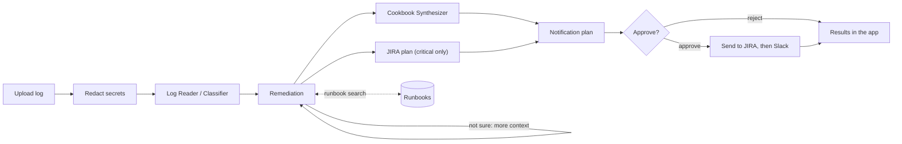

# TriageGraph: multi-agent log analysis for DevOps teams

Upload an ops log. A small team of AI agents reads it, works out what went wrong, suggests a fix for each problem, writes you a checklist, posts the result to Slack and opens JIRA tickets for anything critical.

Built for the Outskill hackathon by team c10-g08.

> **Status:** hackathon build, 10 to 11 Oct 2026. Parsing, the agents, the orchestrator, the Slack and JIRA clients, the app screens, tracing and the evaluation script are done. The evaluation results come next. Links, screenshots and results get filled in as each part lands.

| | |
|---|---|
| Live demo | _coming soon_ |
| Demo video | _coming soon_ |

---

## Why

When something breaks at 3 AM, the on-call engineer gets thousands of log lines and a pager going off. Most of the time goes on reading: which errors matter, which are noise, what changed just before, and whether this has happened before. Then comes the paperwork: post an update, open a ticket, write down what to check.

TriageGraph does that first pass. It doesn't replace the engineer. It hands them a sorted list of problems, a suggested fix for each one with a reason and a source, and a Slack post and JIRA ticket ready to go.

## What it does

1. **Reads the log,** whatever the format. Secrets and personal data are masked first. Each line is split into fields (time, level, service, message, error code, trace ID), and repeated errors are grouped into patterns, so 412 copies of `Connection refused` become one pattern with a count.
2. **Classifies the problems.** Each pattern gets a category (database, memory, disk, TLS, auth and so on), a severity, and the exact log lines that support it.
3. **Finds fixes.** For each issue it searches our runbooks and suggests steps, a likely root cause and the runbook it used. If it's unsure, it pulls more of the log and tries again.
4. **Writes a checklist:** do now, this week, prevent next time.
5. **Asks before sending.** It shows exactly what it would post to Slack and JIRA, and waits for you to approve.
6. **Opens JIRA tickets** for critical issues only. If an issue already has an open ticket, it adds a comment instead of a duplicate. If the old ticket is closed, it opens a new one marked as a regression, and the app shows how it was fixed last time (the closed ticket's last comment).
7. **Posts to Slack:** a short summary in the channel, with the checklist and fixes in a thread and links to the tickets.

You can follow each step in the app, along with the tokens, cost and time each agent used.

## Architecture



The orchestrator is a LangGraph graph. It holds the shared state and decides what runs next: the retry when Remediation needs more context, the checklist and the JIRA plan running side by side, and the pause for approval.

| Agent | Job |
|---|---|
| Log Reader / Classifier | Parse lines, extract fields, group patterns, assign category and severity |
| Remediation | Map each issue to fix steps, a root cause, a rationale and runbook sources |
| Cookbook Synthesizer | Turn the fixes into one ordered checklist |
| JIRA Ticket | Create, comment on or reopen tickets for critical issues |
| Notification | Post the summary and thread to Slack, then link the tickets back to it |
| Orchestrator | The LangGraph graph that ties it together |

## Slack and JIRA

| Direction | How |
|---|---|
| App to JIRA | REST API: find existing tickets, create, comment, link |
| App to Slack | Slack bot: summary post, thread reply, message link |
| JIRA to Slack | Jira Automation rules post when a ticket is assigned or resolved |
| Slack to JIRA | The Jira Cloud app for Slack: ticket previews, plus assign, comment and change status from Slack |

| The run finds... | JIRA | Slack |
|---|---|---|
| Nothing, or only low-severity issues | nothing | nothing (results stay in the app) |
| Medium or high issues | nothing | summary plus checklist thread |
| A new critical issue | new ticket | summary with the ticket link |
| A critical issue with an open ticket | comment on that ticket | summary says it was updated |
| A critical issue whose ticket is closed | new ticket labelled `regression`, linked to the old one | summary flags the regression |
| You reject at the approval step | nothing | nothing |

Each error pattern gets a short hash, and tickets carry it as a label (`sig-<hash>`). That's how the app recognises an issue it has seen before. JIRA is its only memory between runs, so there's no database to run. At most 3 tickets are opened per run.

Slack and JIRA are **off by default**. Without credentials, or with `LIVE_INTEGRATIONS=false`, the app shows exactly what it would have sent and sends nothing. The public demo works this way.

## Tech stack

- Python 3.11+ (we test on 3.12)
- LangGraph for orchestration
- LangChain for model calls and runbook search (an in-memory vector store)
- OpenRouter for every model and embedding call, with one key
- LangSmith for tracing (optional)
- Streamlit for the UI, hosted on Streamlit Community Cloud
- Slack Web API and Jira Cloud REST API v3
- pyarrow for Parquet logs
- Ruff, mypy, pytest, Vulture, Bandit, pip-audit and gitleaks in GitHub Actions

## Run it locally

You need Python 3.11 or newer and Git. An [OpenRouter](https://openrouter.ai) key is needed for live analysis. Slack and JIRA are optional.

```bash
git clone https://github.com/akanani1/c10-g08.git
cd c10-g08

python -m venv .venv
# macOS / Linux
source .venv/bin/activate
# Windows (PowerShell)
.venv\Scripts\Activate.ps1

pip install -r requirements.txt
cp .env.example .env        # on Windows: copy .env.example .env
```

Open `.env` and set `OPENROUTER_API_KEY`. Then:

```bash
streamlit run app.py
```

The app opens at http://localhost:8501. The bar at the top shows what's connected and whether runs are live, and the footer shows the limits. Pick up to three sample logs, upload your own, or paste log lines, then press **Analyse**. Each sample is its own run, and a switch above the results moves between them. The graph lights up as each agent finishes. The results show one card per issue with the fix and why we trust it, the checklist, and exactly what would go to Slack and JIRA. In live mode, nothing is sent until you press **Approve and send**.

After a live run has posted, the **Assistant** column on the right answers "what's happened since?". It reads the replies in the run's Slack thread (and the thread where a repeat incident was first reported) and each ticket's status, assignee and latest comments, then sums them up. It only reads, it needs the admin passcode (opening a settings page asks for it once per session), and its cost shows in the Cost tab. Without a run, for example in a new session, the column offers **Earlier incidents**: it lists the latest TriageGraph tickets from JIRA, and you can ask what has happened to any of them.

The **Replay** tab steps through a finished run with a slider. The graph lights up one step at a time, including the retry when Remediation asked for more context.

The **Timeline** tab shows errors over time, with deploys and config changes marked as dashed lines, so you can see whether a change came just before the errors.

After a run, **Download postmortem draft** gives you a markdown postmortem built from the results: summary, a timeline with deploys and config changes, root causes marked as hypotheses, fixes and follow-ups. It makes no extra model call.

After any run, the **Ask about this run** box in the Assistant column answers questions such as "why is ISS-1 critical?". It looks things up with read-only tools over this run's issues, evidence, fixes, checklist, tickets and costs, cites log line numbers, and stops after 4 lookups.

When an issue has no good runbook, its card offers **Draft a runbook (AI)**. The draft follows our runbook template, is labelled "AI draft, not reviewed", and must pass the same checks as our own runbooks. If you approve it, later runs in your session can use it, and you can download it as a `.md` file. It isn't saved anywhere else.

The left bar is a menu with three pages: **Analyze**, **Agent Settings** and **App Settings**. The assistant stays on the right of every page. **Agent Settings** picks each agent's provider and model (with its price), the OpenRouter key, the token budget, context lines, runbook matches and the retry confidence. **App Settings** covers live mode, approval, the upload limit (up to 5 MB), tickets per run (1 to 5), and the Slack, JIRA and LangSmith settings. Each card has its own Save button.

Opening either settings page asks for `ADMIN_PASSCODE` once per session; without one in your settings, the pages are read-only. The values start from your `.env` or Streamlit secrets, and a saved change applies to every visitor until the app sleeps, restarts or is redeployed. Keys are never shown, only a hint like `sk-o…a1b2` so you can tell which one is in use. Changing where a key is sent (the JIRA site or email, the Slack channel) needs that key too.

To run one full analysis from the command line, as a dry run with real models:

```bash
python -m incident_suite.graph sample_logs/payment_db_conn_refused.log
```

## Configuration

Settings come from `.env` locally, or from the app's Secrets on Streamlit Cloud. `.env.example` lists them all. Leave a value blank to use the default.

| Variable | Required | Default | What it does |
|---|---|---|---|
| `OPENROUTER_API_KEY` | for analysis | | Model calls and embeddings |
| `CLASSIFIER_MODEL` | no | `openai/gpt-4.1-mini` | Log Reader, and Cookbook when `COOKBOOK_MODEL` is blank |
| `REMEDIATION_MODEL` | no | `openai/gpt-5-mini` | Remediation |
| `COOKBOOK_MODEL` | no | same as `CLASSIFIER_MODEL` | Cookbook |
| `EMBEDDING_MODEL` | no | `openai/text-embedding-3-small` | Runbook search |
| `CONTEXT_LINES` | no | `3` | Log lines kept around each error (0 to 20) |
| `RUNBOOK_TOP_K` | no | `3` | Runbooks shown to Remediation (1 to 10) |
| `RETRY_CONFIDENCE` | no | `0.5` | Below this confidence, Remediation tries once more (0 to 1) |
| `LIVE_INTEGRATIONS` | no | `false` | Actually send to Slack and JIRA |
| `REQUIRE_APPROVAL` | no | `true` | Ask before sending to Slack or JIRA |
| `SLACK_BOT_TOKEN` | for Slack | | Bot token with `chat:write` (and `channels:history` for the assistant) |
| `SLACK_CHANNEL_ID` | for Slack | | Where to post |
| `JIRA_BASE_URL` | for JIRA | | Your Atlassian site (https) |
| `JIRA_EMAIL`, `JIRA_API_TOKEN` | for JIRA | | Account and API token |
| `JIRA_PROJECT_KEY` | for JIRA | | The key in your ticket numbers, for example `SCRUM` |
| `JIRA_ISSUE_TYPE` | no | `Task` | Issue type to create |
| `LANGSMITH_TRACING` | no | `false` | Turn tracing on |
| `LANGSMITH_API_KEY` | no | | LangSmith key |
| `LANGSMITH_PROJECT` | no | `c10-g08` | LangSmith project |
| `MAX_UPLOAD_MB` | no | `5` | Upload size limit (1 to 5, Streamlit's own cap) |
| `MAX_TICKETS_PER_RUN` | no | `3` | Ticket cap (1 to 5) |
| `RUN_TOKEN_BUDGET` | no | `200000` | Token cap per run |
| `ADMIN_PASSCODE` | no | | Unlocks the settings pages. When set, live sending in the app also needs it, and everyone else gets a dry run |

Models must be on the allow-list in `incident_suite/config.py`, which also holds their prices for the cost panel. Set a credit limit on your OpenRouter key. Free (`:free`) models work for trying things out, but they're rate-limited.

## Connect Slack, JIRA and LangSmith (optional)

**Slack**
1. Create an app at https://api.slack.com/apps. Under OAuth & Permissions, add the bot scope `chat:write` (and `channels:history` if you want the assistant to read replies), then install the app to your workspace.
2. Copy the bot token (`xoxb-...`) into `SLACK_BOT_TOKEN`.
3. Invite the bot to your channel (`/invite @TriageGraph`) and put the channel ID in `SLACK_CHANNEL_ID`.

**JIRA**
1. Create an API token at https://id.atlassian.com/manage-profile/security/api-tokens.
2. Fill in `JIRA_BASE_URL`, `JIRA_EMAIL`, `JIRA_API_TOKEN` and `JIRA_PROJECT_KEY`.

**Turn it on:** set `LIVE_INTEGRATIONS=true`. To try it from the command line, add `--live`. The run shows what it would send and asks before sending anything:

```bash
python -m incident_suite.graph sample_logs/payment_db_conn_refused.log --live
```

Both clients wait and retry when Slack or JIRA is busy (429 or 5xx), up to three tries, and every call has a timeout. If one service fails, the run says so and carries on with the other.

**Optional, no code needed**
- Install the Jira Cloud app in Slack, so ticket links show previews and can be updated from Slack.
- Add two Jira Automation rules to the project: when an issue labelled `incident-suite` moves to Done, or gets assigned, send a message to the channel through a Slack incoming webhook.

**LangSmith:** set `LANGSMITH_TRACING=true`, `LANGSMITH_API_KEY` and `LANGSMITH_PROJECT`. Each run then gets a trace, and its link shows in the app's Cost tab, at the bottom of the Slack summary and as a link on each JIRA ticket. The trace holds the redacted log text the agents saw.

## Supported log formats

The app detects the format from the content, not just the extension, and turns every format into the same fields before the agents see it.

| Format | Extensions |
|---|---|
| Plain text (app logs, nginx, Kubernetes, syslog) | `.log`, `.txt` |
| JSON lines | `.jsonl`, `.ndjson`, `.json` |
| JSON document (an array, or `{"logs": [...]}`) | `.json` |
| CSV / TSV | `.csv`, `.tsv` |
| Parquet | `.parquet` |
| Any of the above, gzipped | `.gz` (for example `app.log.gz`) |

For CSV, TSV, Parquet and JSON, columns are matched to fields by common names (`timestamp` or `time`, `level` or `severity`, `service` or `host`, `message` or `msg`, `trace_id` or `request_id`, and so on). Other columns are kept. If there's no message column, one is built from the rest. Evidence for structured files points to row numbers.

**Limits:** the upload cap (`MAX_UPLOAD_MB`), then 50 MB decompressed, 200,000 rows or lines, and 200 columns.

**Not supported:** Windows `.evtx`, binary journald files, Excel, and multi-file archives (`.zip`, `.tar`).

## Sample logs and evaluation

`sample_logs/` has 17 made-up but realistic logs in every supported format. Between them they cover:
- database outages, out-of-memory kills and full disks;
- expired certificates, brute-force logins and 5xx spikes;
- timeouts, crash loops, bad config, rate limiting, DNS failures and queue backlogs;
- a healthy log that should raise nothing;
- a repeat of the first outage, to test JIRA dedupe;
- a 50,000-row Parquet file, to show how it handles size.

`labels.json` holds the answers we expect for each one.

All of them are written by `sample_logs/make_samples.py`, so the line numbers in the labels always match. To change a sample, edit the script and run `python sample_logs/make_samples.py`. A test fails if the files and the script disagree.

`data/runbooks/` holds the 15 runbooks the Remediation agent searches.

To score the agents against `labels.json`, run all 17 samples through the real models (dry runs, so nothing is sent; about $0.10 to $0.30):

```bash
python eval/run_eval.py
python eval/run_eval.py --only payment_db_conn_refused.log    # just one
```

It prints this table and one row per log, ready to paste here. An expected issue counts as found when a found issue shares an evidence line, or else has the same service, or else has the label's signature hint in its title.

Results (filled in after the eval run):

| Metric | Result |
|---|---|
| Issues found | _tbd_ |
| Category accuracy | _tbd_ |
| Severity accuracy | _tbd_ |
| Fix mentions the key idea | _tbd_ |
| Critical issues correctly ticketed | _tbd_ |
| Tickets that shouldn't have been opened | _tbd_ |
| Slack decision right | _tbd_ |
| Average per run: tokens / cost / time | _tbd_ |
| 50k-row log: patterns / tokens / cost / time | _tbd_ |

## Security

- **Secrets** only come from environment variables or Streamlit secrets. `.env` is git-ignored, and gitleaks checks every commit.
- **Redaction:** emails, tokens, JWTs, AWS keys, private keys and `password=`-style values are masked before the model sees the log, and only the masked text is shown or sent. This is pattern-based, so unusual formats can slip through.
- **Log content is data,** never instructions to the model. The agents have no tools that run commands or open URLs.
- **Uploads** are limited by type, size, decompressed size, row count and line length.
- **Limits:** 5 runs per 10 minutes per visitor and 60 an hour across everyone, a token budget per run, at most 3 tickets by default (up to 5), and one retry per issue.
- **Nothing reaches Slack or JIRA** without approval. Log text is sent as plain text, never as markup, and URLs found in logs are defanged (`https[:]//`) so they can't become links.
- **The public deployment** keeps Slack and JIRA switched off. When we switch them on for the demo, `ADMIN_PASSCODE` keeps visitors on a dry run.
- **Dependencies** are pinned and checked with pip-audit, and Bandit scans the code.

To report a problem, see [SECURITY.md](.github/SECURITY.md).

## Deployment

The app runs on Streamlit Community Cloud.

1. Sign in at https://share.streamlit.io with GitHub.
2. Create an app from this repo: branch `main`, main file `app.py`.
3. Under Advanced settings, pick Python 3.12 and paste your settings into Secrets in TOML format (`OPENROUTER_API_KEY = "..."`).
4. Deploy. Every push to `main` redeploys.

Free apps go to sleep when nobody has used them for a while, so the first visit after that takes a minute.

## Project layout

```
app.py                  Streamlit page
incident_suite/
  config.py             settings, model allow-list and prices
  state.py              data models shared by the agents, and per-run settings
  graph.py              LangGraph orchestrator, and a dry-run command line
  security.py           upload checks
  telemetry.py          run ID, tokens, cost and time
  parsing/              format detection, readers, parser, redaction, pattern grouping
  agents/               one file per agent; __init__.py holds the model clients
  prompts/              one prompt file per agent
  rag/                  runbook loading and search
  integrations/         Slack and JIRA clients
data/runbooks/          runbooks the Remediation agent searches
sample_logs/            17 sample logs, labels.json and the script that makes them
eval/run_eval.py        scores the agents on the sample logs
tests/                  unit tests that mirror the package, and integration tests
docs/                   build plan, QA checklist, demo video script

pyproject.toml          dependencies and tool settings
requirements.txt        pinned versions, generated from pyproject.toml
.github/                CI, Dependabot, security policy
.streamlit/             Streamlit settings
.env.example            every setting, with placeholder values
```

## Development

```bash
pip install -c requirements.txt -e ".[dev]"   # test and lint tools
pre-commit install                            # checks on every commit

pytest                                        # all tests, no API key needed
pytest -m live                                # real OpenRouter calls (needs the key)
```

CI runs these on every push and pull request:

```bash
ruff check app.py incident_suite eval tests sample_logs
ruff format --check app.py incident_suite eval tests sample_logs
mypy
vulture
bandit -q -c pyproject.toml -r app.py incident_suite eval
pytest --cov
pip-audit -r requirements.txt
```

After changing dependencies in `pyproject.toml`, regenerate the lock file on Python 3.12:

```bash
pip-compile --strip-extras --output-file requirements.txt pyproject.toml
```

## Limitations

- It works on uploaded files. It doesn't watch live log streams.
- It doesn't hear about changes in Slack or JIRA as they happen. It checks JIRA at the start of each run, and the Jira Automation rules handle updates in the other direction.
- Fixes are only as good as the runbooks. When the match is weak it says so instead of guessing, but it can still be wrong. Treat the output as a first pass, not a verdict.
- Redaction is pattern-based and can miss unusual secret formats.

## What's next

A full animated replay, with each agent's input and output, is a later idea. For now the Replay tab steps through the graph.

Later ideas:
- Paging on-call through PagerDuty or Opsgenie.
- Pulling logs straight from Datadog, CloudWatch, Loki or Elasticsearch, or starting a run from an alert.
- Slack buttons and an `/analyze` command (these need a small always-on backend).
- Learning from closed tickets which fixes actually worked.
- Linking incidents to recent GitHub deploys, and publishing postmortems to Confluence.

## Team

Team c10-g08, Outskill hackathon, October 2026.

| Who | Role |
|---|---|
| Ashvin | Lead and core code: agents, orchestration, Slack and JIRA clients, UI |
| Raphael | Integrations and deployment: OpenRouter, Slack, JIRA, LangSmith, Streamlit Cloud |
| Gulam Mohammad | Data: runbooks and evaluation |
| Safwan | QA, documentation and the demo video |

## License

MIT
