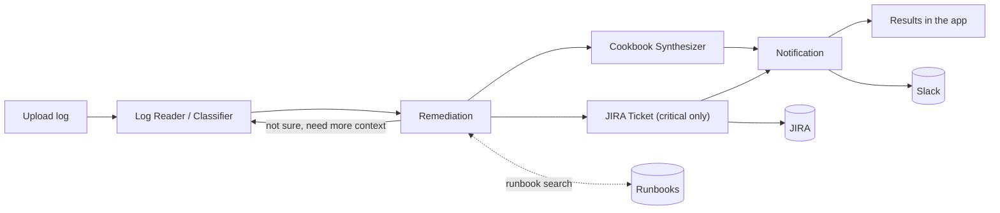
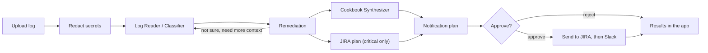

# Incident Suite: multi-agent log analysis for DevOps teams

Upload an ops log. A small team of AI agents reads it, works out what went wrong, finds a fix for each problem, writes you a checklist, posts the result to Slack and opens JIRA tickets for anything critical.

Built for the Outskill hackathon by team c10-g08.

> **Status:** work in progress (hackathon build, 10 to 11 Oct 2026). This README describes what we're building. Links, screenshots and results get filled in as each part lands.

| | |
|---|---|
| Live demo | _coming soon_ |
| Demo video | _coming soon_ |

---

## Why

When something breaks at 3 AM, the on-call engineer gets thousands of log lines and a pager going off. Most of the time goes on reading: which errors matter, which ones are noise, what changed just before, and has this happened before. Then comes the paperwork: post an update, open a ticket, write down what to check.

Incident Suite does that first pass for you. It doesn't replace the engineer. It gives them a sorted list of problems, a suggested fix for each one with a reason and a source, and a Slack post and JIRA ticket already done.

## What it does

1. **Reads the log.** It parses each line into fields (time, level, service, message, error code, trace ID) and groups repeated errors into patterns. 412 copies of `Connection refused` become one pattern with a count.
2. **Classifies the problems.** Each pattern gets a category (database, memory, disk, TLS, auth, and so on) and a severity, along with the exact log lines that support it.
3. **Finds fixes.** For each issue it searches our runbooks and suggests steps, says why, and cites the runbook it used. If it's unsure, it goes back to the log for more context before answering.
4. **Writes a checklist.** Do now, do this week, prevent next time.
5. **Opens JIRA tickets** for critical issues only. It won't create a duplicate if the issue already has an open ticket; it adds a comment instead.
6. **Posts to Slack**: a short summary in the channel and the full checklist in a thread, with buttons for the tickets.

You can watch every step happen in the app, along with how many tokens and how much money each step used.

## Architecture



The orchestrator is a LangGraph graph. It holds the shared state and decides what runs next, including the feedback loop between Remediation and the Log Reader and the parallel step for the checklist and JIRA.

| Agent | Job |
|---|---|
| Log Reader / Classifier | Parse lines, extract fields, group patterns, assign category and severity |
| Remediation | Map each issue to a fix, a rationale and a runbook source |
| Cookbook Synthesizer | Turn the fixes into an ordered checklist |
| JIRA Ticket | Create or update tickets for critical issues |
| Notification | Post the summary and thread to Slack, then link the tickets back to it |
| Orchestrator | LangGraph graph that ties it all together |

## Slack and JIRA

Here's what talks to what:

| Direction | How |
|---|---|
| App to JIRA | REST API: search for existing tickets, create, comment, link |
| App to Slack | Slack bot: summary post, thread reply, message link |
| JIRA to Slack | Jira Automation rules post when a ticket is assigned or resolved |
| Slack to JIRA | The Jira Cloud app for Slack: ticket previews, plus assign, comment and change status from Slack |

When things get created:

| The run finds... | JIRA | Slack |
|---|---|---|
| Nothing, or only low-severity issues | nothing | nothing (results stay in the app) |
| Medium or high issues | nothing | summary plus checklist thread |
| A new critical issue | new ticket | summary with ticket button |
| A critical issue that already has an open ticket | comment on the existing ticket | summary says it was updated |
| A critical issue whose old ticket is closed | new ticket, labelled `regression` and linked to the old one | summary flags it as a regression |

We use a label to tell whether we've seen an issue before. Each error pattern gets a short hash (`sig-<hash>`), and that hash goes on the ticket. JIRA is the only memory between runs, so there's no database to run.

Slack and JIRA are **off by default**. Without credentials, or with `LIVE_INTEGRATIONS=false`, the app shows you exactly what it would have sent and doesn't send anything. That's how the public demo works.

## Tech stack

- **Python 3.11+**
- **LangGraph** for orchestration
- **LangChain** with **OpenAI** for the model calls
- **LangChain** vector store with **OpenAI embeddings** for runbook search (small enough to keep in memory)
- **LangSmith** for tracing (optional)
- **Streamlit** for the UI
- **Slack Web API** and **Jira Cloud REST API v3**
- Ruff, mypy, pytest, Bandit, pip-audit, Vulture and gitleaks, all in GitHub Actions

## Run it locally

You need Python 3.11 or newer and Git. Slack and JIRA are optional; the app runs fine without them.

```bash
git clone https://github.com/akanani1/c10-g08.git
cd c10-g08

python -m venv .venv
# macOS / Linux
source .venv/bin/activate
# Windows (PowerShell)
.venv\Scripts\Activate.ps1

pip install -r requirements.txt
cp .env.example .env        # on Windows: copy .env.example .env
```

Open `.env` and set `OPENROUTER_API_KEY`. Then:

```bash
streamlit run app.py
```

The app opens at http://localhost:8501. Pick a sample log from the sidebar, or upload your own.

### For developers

```bash
pip install -c requirements.txt -e ".[dev]"   # test and lint tools
pre-commit install                            # checks on every commit

pytest                                        # tests, no API key needed
pytest -m live                                # real OpenRouter calls (needs the key)

# What CI runs
ruff check app.py incident_suite tests sample_logs
ruff format --check app.py incident_suite tests sample_logs
mypy
vulture
bandit -q -c pyproject.toml -r app.py incident_suite
pytest --cov
pip-audit -r requirements.txt

# After changing dependencies in pyproject.toml (on Python 3.12)
pip-compile --strip-extras --output-file requirements.txt pyproject.toml
```

## Connect Slack, JIRA and LangSmith (optional)

**Slack**
1. Create an app at https://api.slack.com/apps. Under OAuth & Permissions, add the bot scope `chat:write`, then install it to your workspace.
2. Copy the bot token (`xoxb-...`) into `SLACK_BOT_TOKEN`.
3. Invite the bot to your channel (`/invite @Incident Suite`) and put the channel ID in `SLACK_CHANNEL_ID`.

**JIRA**
1. Create an API token at https://id.atlassian.com/manage-profile/security/api-tokens.
2. Fill in `JIRA_BASE_URL` (for example `https://yourteam.atlassian.net`), `JIRA_EMAIL`, `JIRA_API_TOKEN` and `JIRA_PROJECT_KEY`.

**Turn it on:** set `LIVE_INTEGRATIONS=true`.

**Optional, no code needed:**
- Install the Jira Cloud app in Slack, so ticket links show previews and can be updated from Slack.
- Add two Jira Automation rules to the project. When an issue labelled `incident-suite` moves to Done, or gets assigned, send a Slack message to the channel through an incoming webhook.

**LangSmith:** set `LANGSMITH_TRACING=true`, `LANGSMITH_API_KEY` and `LANGSMITH_PROJECT`.

## Configuration

| Variable | Required | Default | What it does |
|---|---|---|---|
| `OPENAI_API_KEY` | yes | | Model calls and embeddings |
| `CLASSIFIER_MODEL` | no | set in config | Model for the Log Reader |
| `REMEDIATION_MODEL` | no | set in config | Model for Remediation |
| `LIVE_INTEGRATIONS` | no | `false` | Actually send to Slack and JIRA |
| `SLACK_BOT_TOKEN` | for Slack | | Bot token with `chat:write` |
| `SLACK_CHANNEL_ID` | for Slack | | Where to post |
| `JIRA_BASE_URL` | for JIRA | | Your Atlassian site |
| `JIRA_EMAIL` | for JIRA | | Account for the API token |
| `JIRA_API_TOKEN` | for JIRA | | API token |
| `JIRA_PROJECT_KEY` | for JIRA | | e.g. `OPS` |
| `JIRA_ISSUE_TYPE` | no | `Task` | Issue type to create |
| `MAX_UPLOAD_MB` | no | `5` | Upload size limit |
| `MAX_TICKETS_PER_RUN` | no | `3` | Cap on tickets per run |
| `RUN_TOKEN_BUDGET` | no | set in config | Cap on tokens per run |
| `LANGSMITH_TRACING` | no | `false` | Turn tracing on |
| `LANGSMITH_API_KEY` | no | | LangSmith key |
| `LANGSMITH_PROJECT` | no | `c10-g08` | LangSmith project |

## Sample logs and evaluation

`sample_logs/` has 17 made-up but realistic logs covering every supported format: plain-text app logs, syslog, Kubernetes, nginx access and error logs, JSON lines, JSON documents, CSV, TSV, Parquet and gzip. Between them they cover database outages, out-of-memory kills, full disks, expired certificates, brute-force logins, 5xx spikes, timeouts, crash loops, bad config, rate limiting, DNS failures and queue backlogs, plus a healthy log that should raise nothing and a repeat of the first outage to test JIRA dedupe. One is a 50,000-row Parquet file, to show how it handles size. `labels.json` holds the answers we expect for each log.

All of them, and `labels.json`, are written by `sample_logs/make_samples.py`, so line numbers in the labels always match. To change a sample, edit the script and run `python sample_logs/make_samples.py`; a test fails if the committed files and the script disagree.

Results (filled in after running the eval script):

| Metric | Result |
|---|---|
| Category accuracy | _tbd_ |
| Severity accuracy | _tbd_ |
| Critical issues correctly ticketed | _tbd_ |
| Average cost per run | _tbd_ |
| 50k-line log: patterns / tokens / cost | _tbd_ |

## Security

- Secrets come from environment variables or Streamlit secrets only. `.env` is git-ignored, and gitleaks checks every commit.
- Log content is treated as data, never as instructions to the model. The agents have no tools that run commands or open URLs.
- Uploads are limited by file type, size and line length.
- There's a per-session rate limit and a token budget per run, and at most 3 tickets per run.
- Anything sent to Slack or JIRA is escaped first.
- Slack and JIRA are off by default on the public deployment.
- Dependencies are pinned and checked with pip-audit. Bandit scans the code.

## Deployment

The app runs on Streamlit Community Cloud.

1. Sign in at https://share.streamlit.io with GitHub.
2. Create an app from this repo, branch `main`, main file `app.py`.
3. Under Advanced settings pick Python 3.12, then paste the variables above into the app's Secrets settings, in TOML format (`OPENROUTER_API_KEY = "..."`).
4. Deploy. Every push to `main` redeploys automatically.

Free apps go to sleep when nobody uses them for a while. The first visit after that takes a minute to wake up.

## Project layout

```
app.py                  Streamlit UI
incident_suite/
  graph.py              LangGraph orchestrator
  state.py              data models shared between agents
  parsing/              log format detection, parsing, pattern grouping
  agents/               one file per agent; __init__.py holds the shared model access
  prompts/              one prompt file per agent
  rag/                  runbook index and search
  integrations/         Slack and JIRA clients, message builders
  security.py           upload checks, rate limits, escaping
  telemetry.py          run ID, tokens, cost, timing
  config.py             settings
data/runbooks/          the runbooks the Remediation agent searches
sample_logs/            17 sample logs and their labels
eval/                   evaluation script
tests/                  unit and end-to-end tests
docs/                   diagrams, screenshots, setup guides

pyproject.toml          dependencies and tool settings
requirements.txt        pinned versions, generated from pyproject.toml
.github/                CI, Dependabot, security policy
.streamlit/             Streamlit settings
.env.example            every setting, with placeholder values
```

## Limitations

- The app only reacts to uploads. It doesn't watch live log streams yet.
- It doesn't hear about changes in Slack or JIRA as they happen. It checks JIRA at the start of each run, and the Jira Automation rules handle updates in the other direction.
- Fixes are only as good as the runbooks. With a weak match it tells you so instead of guessing, but it can still be wrong. Treat the output as a first pass, not a verdict.

## What's next

- Paging on-call through PagerDuty or Opsgenie for critical issues
- Pulling logs straight from Datadog, CloudWatch, Loki or Elasticsearch, or starting a run from an alert
- Slack buttons and a `/analyze` command (needs a small always-on backend)
- Learning from closed tickets which fixes actually worked
- Linking incidents to recent GitHub deploys, and publishing postmortems to Confluence

## Additions in progress

These came out of a review of the team's UI mockups. They add to the sections above without changing them, and the build plan (sections 18 and 19) has the details.

**Secret and PII redaction.** Before the Log Reader sees anything, the app masks email addresses, bearer tokens and JWTs, AWS access keys, private key blocks, and the values of `password=`, `token=`, `api_key=` and similar fields. Each one becomes `[REDACTED:<type>]`, and the app shows how many of each it masked. Everything after that step works on the redacted text: the model, the evidence lines on screen, Slack and JIRA. It's pattern-based, so it can miss unusual formats.

**Approval before anything is sent.** The JIRA and Slack agents first prepare their tickets and messages without sending anything. The run then pauses and shows exactly what would go out. **Approve** sends it; **Reject** sends nothing and records the rejection. This uses LangGraph's built-in pause and resume. In dry run, the run stops at this point with the previews on screen.



**Results screen.** For each top issue, an incident card shows the severity, service, run ID, likely root cause, recommended fix, and a confidence score with its reasons: how many log lines support it, how well a runbook matched, and whether JIRA has seen it before. Alongside it: a strip showing each step's status and time, Slack and JIRA previews, the runbooks used, a run log table, cost per agent, and a severity legend. Everything on it comes from the current run. There are no made-up dashboard numbers.

**New setting**

| Variable | Required | Default | What it does |
|---|---|---|---|
| `REQUIRE_APPROVAL` | no | `true` | Pause for approval before sending to Slack or JIRA |

**Maybe, if time allows:** reusing the fix from a closed JIRA ticket for the same issue ("last time this was fixed by…"), an error timeline with deploys marked, a chat to ask questions about the incident, a postmortem draft download, and pasting logs as text.

## Agent settings page (if time allows)

A second page in the app with one card per agent: pick the model (from a fixed list, with its price), edit the system prompt, and tune a few settings such as runbook matches, the retry threshold and the ticket cap. A global card covers the token budget, approval, redaction and dry run, and shows whether Slack, JIRA and LangSmith are connected (never the keys).

Changes apply to your session only. You can export them as JSON and import them later, and reset to the defaults at any time. If you edit a prompt, the run switches to dry run, so edited prompts can't post to Slack or JIRA unless an admin passcode is entered.

| Variable | Required | Default | What it does |
|---|---|---|---|
| `ADMIN_PASSCODE` | no | | Lets a session with edited prompts send to Slack and JIRA |

## Using OpenRouter

All model calls and embeddings go through [OpenRouter](https://openrouter.ai), so you only need one key. It replaces `OPENAI_API_KEY` in the sections above.

| Variable | Required | Default | What it does |
|---|---|---|---|
| `OPENROUTER_API_KEY` | yes | | Model calls and embeddings through OpenRouter |
| `CLASSIFIER_MODEL`, `REMEDIATION_MODEL`, `EMBEDDING_MODEL` | no | set in config | OpenRouter model names, e.g. `openai/text-embedding-3-small` |

Set a credit limit on the key in your OpenRouter account. Free (`:free`) models work for trying things out but are rate-limited.

## Team roles

| Who | Role |
|---|---|
| Ashvin | Lead and core code: agents, LangGraph orchestration, Slack and JIRA clients, UI |
| Raphael | Integrations and deployment: OpenRouter, Slack, JIRA, LangSmith, Streamlit Cloud |
| Gulam Mohammad | Data: sample logs, labels, runbooks, evaluation |
| Safwan | QA, documentation and the demo video |

## Supported log formats

Upload logs in whatever shape you have them. The app detects the format from the content (not just the file extension) and turns every format into the same fields before the agents see it.

| Format | Extensions |
|---|---|
| Plain text (app logs, nginx, Kubernetes, syslog) | `.log`, `.txt` |
| JSON lines | `.jsonl`, `.ndjson`, `.json` |
| JSON document (an array of records, or `{"logs": [...]}`) | `.json` |
| CSV / TSV | `.csv`, `.tsv` |
| Parquet | `.parquet` |
| Any of the above, gzipped | `.gz` (e.g. `app.log.gz`) |

For CSV, TSV, Parquet and JSON, columns are matched to fields by common names (`timestamp`/`time`, `level`/`severity`, `service`/`host`, `message`/`msg`, `trace_id`/`request_id` and so on). Other columns are kept, and if there's no message column the app builds one from the rest. The app shows which mapping it used, and evidence for structured files points to row numbers.

Limits: the upload cap (`MAX_UPLOAD_MB`, default 5) plus caps after reading: 50 MB decompressed, 200,000 rows or lines, and 200 columns. Not supported yet: Windows `.evtx`, binary journald files, Excel, and multi-file archives (`.zip`, `.tar`).

The sample logs cover every format, including a 50,000-row Parquet file.

## Team

Team c10-g08, Outskill hackathon, October 2026.

## License

MIT
